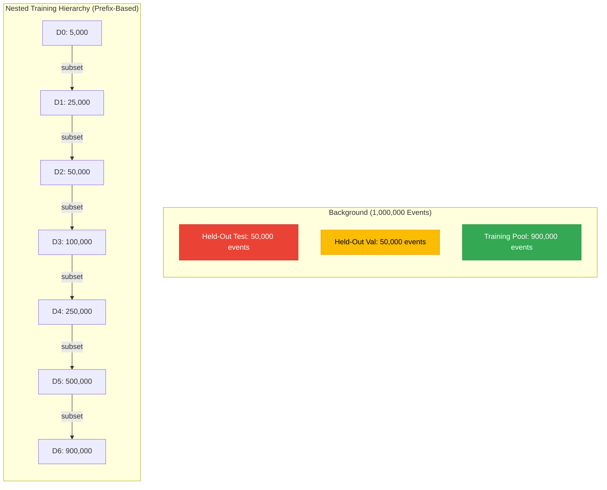

# Dataset Integrity & Provenance Report: Scaling Study Partitions

**Document ID:** `reports/scaling/DATASET_INTEGRITY_REPORT.md`  
**Protocol Version:** 1.0.0  
**Partition Generator:** [`src/data/scaling_split.py`](file:///Users/koul/Library/Mobile%20Documents/com~apple~CloudDocs/anomaly-detector-gnn/src/data/scaling_split.py)  
**Manifests:** [`results/scaling/manifests/dataset_manifest.json`](file:///Users/koul/Library/Mobile%20Documents/com~apple~CloudDocs/anomaly-detector-gnn/results/scaling/manifests/dataset_manifest.json)  
**Date:** October 31, 2026  

---

## 1. Master Partition Inventory & Cryptographic SHA-256 Manifest

All dataset partitions were generated deterministically using pseudo-random permutation seed `20261031` for background MC and `20261032` for signal MC.

| Partition Identifier | Target File | Event Count | Array Shape | SHA-256 Hex Digest | Min Index | Max Index |
| :--- | :--- | :---: | :---: | :--- | :---: | :---: |
| **Held-Out Test (BG)** | `data/splits/bg_test_50k.npy` | 50,000 | `(50000,)` | `a5b6a4cc115758ac0528e12d4dbef0d9fdbbb4246db1eb02c918ec2cbfafe9c9` | 3 | 999,997 |
| **Held-Out Val (BG)** | `data/splits/bg_val_50k.npy` | 50,000 | `(50000,)` | `1e72579a39ebdf12066cbbdd05b4b73b5e43bc20c5861b581459a96e05ad9d44` | 13 | 999,957 |
| **Training Tier D0** | `data/splits/bg_train_d0_5k.npy` | 5,000 | `(5000,)` | `c232c45b77b40129759d5718dfd55c7a522396bf5bf6083aa2ce58ebfe77f11c` | 27 | 999,879 |
| **Training Tier D1** | `data/splits/bg_train_d1_25k.npy` | 25,000 | `(25000,)` | `2c075d3c25a229cf55ff1b98b9560f4da412140bb6f1e2928574d6f45217fcff` | 27 | 999,955 |
| **Training Tier D2** | `data/splits/bg_train_d2_50k.npy` | 50,000 | `(50000,)` | `a0643ab9b4d6b96cbf4d8a1dbfbcc924dfbfdf372e9d3d3c81216839352e8250` | 27 | 999,977 |
| **Training Tier D3** | `data/splits/bg_train_d3_100k.npy` | 100,000 | `(100000,)` | `e43b37a77f6ca99aee96277a0668b8e0573c7f12e1ec18e7e1f48641a967520e` | 27 | 999,985 |
| **Training Tier D4** | `data/splits/bg_train_d4_250k.npy` | 250,000 | `(250000,)` | `c8ee32b54870660c6d7a4f910408544cb4828f73b306448375681c2017c60317` | 0 | 999,996 |
| **Training Tier D5** | `data/splits/bg_train_d5_500k.npy` | 500,000 | `(500000,)` | `59a45640c78f2cae582d03998f413d7e5e347ce6c0dfd02a0a256df24c77db63` | 0 | 999,998 |
| **Training Tier D6** | `data/splits/bg_train_d6_900k.npy` | 900,000 | `(900000,)` | `d67b360862889cd181cb2d5bfb98ea8f3f83556ff86c8f96ce9e584fbb3a0100` | 0 | 999,999 |
| **Signal Test Pool** | `data/splits/sig_test_25k.npy` | 25,000 | `(25000,)` | `1bb9f10dd56fe2070fa324cb89a531cfb565a0c0e7b78972df5c8ad18fa66190` | 4 | 99,997 |
| **Signal Val Pool** | `data/splits/sig_val_25k.npy` | 25,000 | `(25000,)` | `f8017f23f4b2b4adc2cfc2ba6aa66a416a1b80c65507ca1ae67dfd221873ea45` | 1 | 99,994 |
| **Signal Reserve** | `data/splits/sig_reserve_50k.npy` | 50,000 | `(50000,)` | `98c62ddd32051a654c6001ce5f5697669d510f2795f9e98418579d469446d3e8` | 0 | 99,999 |

---

## 2. Mathematical Integrity & Non-Overlap Verification

### Verification Gate Results
1. **Background Mutual Exclusivity:**
   - $|\text{Test} \cap \text{Val}| = 0$ (Verified empty)
   - $|\text{Test} \cap \text{Train Pool}| = 0$ (Verified empty)
   - $|\text{Val} \cap \text{Train Pool}| = 0$ (Verified empty)
2. **Nested Subset Property:**
   - $D_0 \subset D_1 \subset D_2 \subset D_3 \subset D_4 \subset D_5 \subset D_6$ (Verified strict subsets for all pairs)
3. **Signal Partition Exclusivity:**
   - $|\text{Sig Test} \cap \text{Sig Val}| = 0$ (Verified empty)
   - $|\text{Sig Test} \cap \text{Sig Reserve}| = 0$ (Verified empty)
   - $|\text{Sig Val} \cap \text{Sig Reserve}| = 0$ (Verified empty)
4. **Signal Leakage into Training Pool:**
   - The training pool is sourced purely from `events_LHCO2020_backgroundMC_Pythia.h5`. Zero signal events exist in the background file. Signal leakage count: **0 events**.
